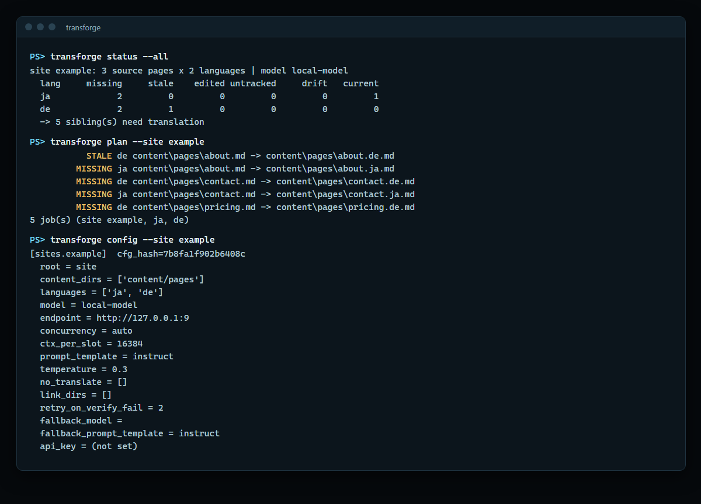
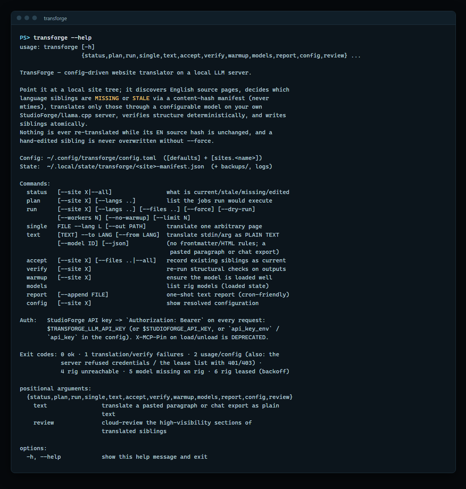

# TransForge

<table>
  <tr>
    <td width="50%"><br><sub><code>status</code> and <code>plan</code> show which language siblings are current, stale or missing, decided by content hash rather than file times.</sub></td>
    <td width="50%"><br><sub>The full command set, config locations, auth and exit codes in <code>transforge --help</code>.</sub></td>
  </tr>
</table>

<sub>Terminal renderings of a real run against a three-page example site; no model server was contacted.</sub>

Config-driven website translator that runs entirely on your own local LLM server — no cloud APIs, no per-word cost. Content-hash manifests translate only what changed, structural verification catches broken output, writes are atomic, and hand-edited translations are never overwritten.

It talks to a StudioForge/llama.cpp server (e.g. `http://localhost:1234`),
discovers English source pages in a site tree, decides which language siblings
are missing or stale using a **content-hash manifest** (never mtimes),
translates only those, verifies the output structurally, and writes siblings
atomically. A hand-edited sibling is never overwritten without `--force`.

Two files: `transforge.py` (the CLI) and `review.py` (the optional review
stage, loaded from the same directory). Requires Python 3.11+ (`tomllib`) and
PyYAML.

## Install

Pick your platform; in each, method 1 is the simplest. TransForge is a one-shot command-line tool, so there is no service to start. It only calls
your LLM server (the StudioForge gateway `/v1`, for example `http://localhost:1234`).

| Port | What |
|---|---|
| none | TransForge opens no port of its own. It only makes outbound calls to the LLM server (default `http://127.0.0.1:1234/v1`, the StudioForge **gateway**; the panel on :8080 does not serve `/v1`). |

From a container, reach the host's server at `host.docker.internal`; it must listen on an address the container can reach.

Needs Python 3.11 or newer; `uv` fetches one
for you, so you rarely have to check. If the gateway requires a key, set `TRANSFORGE_LLM_API_KEY` (shown below). Never `pip install .` with the
system Python on Debian/Ubuntu: it is refused (PEP 668), so every method below uses `uv`, `pipx` or a venv.

After installing, write a config once (see "First run" below), then `transforge status --all` (offline: it reads
your site tree and manifests and never contacts the rig; exit 1 means work is pending) and `transforge models`
(asks the LLM server: confirms it is reachable and lists its models; exit 4 means unreachable).
`transforge --version` prints the installed version.

### Windows

Run the blocks in PowerShell. After a `winget install`, close and reopen PowerShell.

#### 1. `uv tool install` (simplest)

Choose this to get a `transforge` command on `PATH` with no clone and no venv to manage.

```powershell
winget install --id Git.Git -e --source winget
winget install --id astral-sh.uv -e --source winget
# close and reopen PowerShell, then:
uv tool install --python 3.13 git+https://github.com/LaserLloyd/TransForge   # scrub-ok: public repo URL
uv tool update-shell        # puts uv's tool folder on PATH; close and reopen PowerShell if it says so
transforge --help
```

| Pros | Cons |
|---|---|
| One command; `transforge` is on `PATH` in every folder | Needs git for the first fetch, and uv |
| uv fetches Python 3.13 itself and keeps the tool in its own venv | To edit the code, use method 2 |
| Upgrade and remove with one command each | `PATH` takes one `update-shell` plus a new window |

#### 2. venv from a clone

Choose this to edit the code or when you prefer plain `pip`.

```powershell
winget install --id Git.Git -e --source winget
winget install --id Python.Python.3.12 -e --source winget
# close and reopen PowerShell, then:
git clone https://github.com/LaserLloyd/TransForge.git   # scrub-ok: public repo URL
cd TransForge
py -3 -m venv .venv
.\.venv\Scripts\python.exe -m pip install .
.\.venv\Scripts\transforge.exe --help
```

Run it as `.\.venv\Scripts\transforge.exe ...` from the clone, or add `...\TransForge\.venv\Scripts` to `PATH`. Use `pip install -e .` to edit in place.

| Pros | Cons |
|---|---|
| Plain tools: Python, pip, git | The command is not on `PATH` until you add it |
| Editable with `pip install -e .` | Most steps; you manage Python and updates |

#### 3. Docker Desktop

Choose this when you do not want Python on the machine. The config lives in a folder you edit, the manifests on a Docker volume.

```powershell
winget install --id Git.Git -e --source winget
winget install --id Docker.DockerDesktop -e --source winget
# start Docker Desktop once and wait until it says the engine is running, then:
git clone https://github.com/LaserLloyd/TransForge.git   # scrub-ok: public repo URL
cd TransForge
New-Item -ItemType Directory -Force deploy\compose\config, deploy\compose\sites | Out-Null
Copy-Item -Recurse C:\path\to\your\site deploy\compose\sites\example     # or set SITES_PATH in deploy\compose\.env
Copy-Item deploy\compose\.env.example deploy\compose\.env
# optional: edit deploy\compose\.env (LLM_BASE_URL, TRANSFORGE_LLM_API_KEY); the default is http://host.docker.internal:1234/v1
docker compose -f deploy/compose/compose.yml run --rm app status --all
```

The first run writes `deploy\compose\config\config.toml`; edit it (see "First run"), then run `... run --rm app models`.

| Pros | Cons |
|---|---|
| No Python; read-only, non-root image | Docker Desktop is a large install |
| Manifests on a named volume that survives upgrades | Site roots in `config.toml` are container paths (`/sites/example`) |
| Optional `schedule` profile re-runs a command on an interval | The LLM server on the host must accept connections from the container, not only on the host's `127.0.0.1` |

### Linux

Blocks assume Ubuntu or Debian (apt). A bare Ubuntu image has no `git` or `curl`, so the first line installs them.

#### 1. `uv tool install` (simplest)

Choose this to get a `transforge` command on `PATH` with no clone and no venv to manage.

```bash
sudo apt-get update && sudo apt-get install -y git curl ca-certificates
curl -LsSf https://astral.sh/uv/install.sh | sh
source $HOME/.local/bin/env
uv tool install --python 3.13 git+https://github.com/LaserLloyd/TransForge   # scrub-ok: public repo URL
transforge --help
```

| Pros | Cons |
|---|---|
| One command after uv; no PEP 668 error; `transforge` is on `PATH` | Needs git and uv |
| uv fetches Python 3.13 itself, so an old system Python does not matter | To edit the code, use method 3 |
| Upgrade and remove with one command each | New shells need `$HOME/.local/bin` on `PATH` (the uv installer adds it to your profile) |

#### 2. `pipx`

Choose this if you already use pipx and your system Python is 3.11 or newer (Ubuntu 24.04 and Debian 12 are; Ubuntu 22.04 ships 3.10, so use method 1).

```bash
sudo apt-get update && sudo apt-get install -y git pipx
pipx ensurepath
export PATH="$HOME/.local/bin:$PATH"
pipx install git+https://github.com/LaserLloyd/TransForge   # scrub-ok: public repo URL
transforge --help
```

| Pros | Cons |
|---|---|
| Isolated venv, command on `PATH`, no PEP 668 error | Uses your system Python, which must be 3.11 or newer |
| Plain apt packages | `pipx ensurepath` needs a new shell to take effect |

#### 3. venv from a clone

Choose this to edit the code.

```bash
sudo apt-get update && sudo apt-get install -y git python3-venv
git clone https://github.com/LaserLloyd/TransForge.git && cd TransForge   # scrub-ok: public repo URL
python3 -m venv ~/.local/share/transforge-venv
~/.local/share/transforge-venv/bin/pip install .
mkdir -p ~/.local/bin && ln -sf ~/.local/share/transforge-venv/bin/transforge ~/.local/bin/transforge
export PATH="$HOME/.local/bin:$PATH"
transforge --help
```

| Pros | Cons |
|---|---|
| Plain tools: Python, pip, git; `pip install -e .` to edit in place | Most steps; you manage Python and updates |
| The clone is the source of truth for your changes | System Python must be 3.11 or newer |

#### 4. Docker Compose

Choose this when you do not want Python on the machine. The config lives in a folder you edit, the manifests on a Docker volume.

```bash
sudo apt-get update && sudo apt-get install -y git docker.io docker-compose-v2
sudo usermod -aG docker $USER      # log out and in once, or prefix the docker lines below with sudo
git clone https://github.com/LaserLloyd/TransForge.git && cd TransForge   # scrub-ok: public repo URL
mkdir -p deploy/compose/config deploy/compose/sites
cp -r /path/to/your/site deploy/compose/sites/example      # or set SITES_PATH in deploy/compose/.env
sudo chown -R 1000:1000 deploy/compose/config deploy/compose/sites     # the image runs as UID 1000
cp deploy/compose/.env.example deploy/compose/.env
# optional: edit deploy/compose/.env (LLM_BASE_URL, TRANSFORGE_LLM_API_KEY); the default is http://host.docker.internal:1234/v1
docker compose -f deploy/compose/compose.yml run --rm app status --all
```

The first run writes `deploy/compose/config/config.toml`; edit it (see "First run"), then run `... run --rm app models`. Translations are written next to your
sources in `deploy/compose/sites/`, so copy them back or point `SITES_PATH` at your real site tree (it must be writable by UID 1000, or use `compose.puid.yml`).

| Pros | Cons |
|---|---|
| No Python; read-only, non-root image | Needs a Docker engine; config and site paths need the UID 1000 step |
| Manifests on a named volume that survives upgrades | Site roots in `config.toml` are container paths (`/sites/example`) |
| Optional `schedule` profile re-runs a command on an interval | The LLM server on the host must listen on an address the container can reach |

### macOS

The tool is plain Python with one dependency (PyYAML), so nothing is macOS-specific.

#### 1. `uv tool install` (simplest)

```bash
brew install git uv
uv tool install --python 3.13 git+https://github.com/LaserLloyd/TransForge   # scrub-ok: public repo URL
uv tool update-shell        # then open a new Terminal window
transforge --help
```

| Pros | Cons |
|---|---|
| One command after Homebrew; no clone | Needs Homebrew (<https://brew.sh>) |

#### 2. Docker Desktop

Same files and steps as Linux method 4, with Docker Desktop in place of the engine and no `chown` line:

```bash
brew install git
brew install --cask docker     # then open Docker Desktop once and wait for "Engine running"
git clone https://github.com/LaserLloyd/TransForge.git && cd TransForge   # scrub-ok: public repo URL
mkdir -p deploy/compose/config deploy/compose/sites
cp -r /path/to/your/site deploy/compose/sites/example
cp deploy/compose/.env.example deploy/compose/.env
docker compose -f deploy/compose/compose.yml run --rm app status --all
```

| Pros | Cons |
|---|---|
| No Python | Docker Desktop is a large install |

### First run (native installs)

TransForge reads `~/.config/transforge/config.toml` (on Windows `%USERPROFILE%\.config\transforge\config.toml`) and refuses to start without it.
Write a minimal one, point `endpoint` at the gateway root (no `/v1`), and set `model` to a full StudioForge model id (`transforge models` lists them).

```bash
mkdir -p ~/.config/transforge
cat > ~/.config/transforge/config.toml <<'EOF'
[defaults]
endpoint = "http://localhost:1234"
model = "publisher/repo/file-stem"

[sites.example]
root = "~/sites/example"
content_dirs = ["content/projects", "content/pages"]
languages = ["ja", "de"]
lang_names = { ja = "Japanese", de = "German" }
link_dirs = ["projects"]
no_translate = []
translate_fields = ["title", "excerpt"]
EOF
export TRANSFORGE_LLM_API_KEY=...       # only if the gateway requires a key
transforge config                        # resolved config; offline
transforge models                        # what the server offers
transforge run --site example --dry-run
```

PowerShell:

```powershell
New-Item -ItemType Directory -Force $HOME\.config\transforge | Out-Null
[IO.File]::WriteAllText("$HOME\.config\transforge\config.toml", @'
[defaults]
endpoint = "http://localhost:1234"
model = "publisher/repo/file-stem"

[sites.example]
root = "~/sites/example"
content_dirs = ["content/projects", "content/pages"]
languages = ["ja", "de"]
lang_names = { ja = "Japanese", de = "German" }
link_dirs = ["projects"]
no_translate = []
translate_fields = ["title", "excerpt"]
'@)
$env:TRANSFORGE_LLM_API_KEY = "..."      # this window only; setx TRANSFORGE_LLM_API_KEY "..." keeps it
transforge config
```

### Upgrade and uninstall

- **`uv tool`:** `uv tool install --reinstall git+https://github.com/LaserLloyd/TransForge` upgrades (rollback: add `@<tag or commit>` to the URL);   <!-- scrub-ok: public repo URL -->
  `uv tool uninstall transforge` removes it.
- **`pipx`:** `pipx install --force git+https://github.com/LaserLloyd/TransForge` upgrades; `pipx uninstall transforge` removes it.   <!-- scrub-ok: public repo URL -->
- **venv from a clone:** `git pull` and `pip install .` again with the venv's pip; uninstall = delete the venv and the clone.
- **Docker:** `git pull` then `docker compose -f deploy/compose/compose.yml build`; roll back with `git checkout` of the earlier commit and the same `build`.
  `docker compose ... down` keeps the `transforge-state` volume; **`down -v` deletes the manifests** (translations stay, but TransForge then treats existing
  siblings as `UNTRACKED` until you run `transforge accept`). On the first start of a new image version the config and manifests are copied to
  `image-backups/` in the volume (last 5 kept).

Uninstalling the program never touches your data: the config (`~/.config/transforge/`), the manifests and backups (`~/.local/state/transforge/`) and your
translated pages stay. Delete the first two yourself only if you are done with the site; the manifests are what protect hand-edited translations.

Docker settings in `deploy/compose/.env`:

| Variable | Default | |
|---|---|---|
| `LLM_BASE_URL` | `http://host.docker.internal:1234/v1` | your StudioForge / llama.cpp server as the container sees it; seeds `endpoint` once (a trailing `/v1` is dropped) |
| `TRANSFORGE_LLM_API_KEY` | empty | StudioForge API key, sent as `Authorization: Bearer` on every request (see "Warmup, concurrency, leases") |
| `STUDIOFORGE_MCP_PIN` | empty | legacy management PIN for warmup / load-recommended (deprecated as of 0.2.0, removed in the next release; not needed with an API key) |
| `DEEPSEEK_API_KEY` | empty | only for the opt-in `review` stage |
| `CONFIG_PATH` / `SITES_PATH` | `./config` / `./sites` | host paths, relative to `deploy/compose/` |

Scheduled translation in Docker (optional, `restart: unless-stopped`):

```bash
TRANSFORGE_SCHEDULE_CMD="run --site example" docker compose -f deploy/compose/compose.yml --profile schedule up -d
```

Back up the state volume (scheduler stopped):

```bash
docker compose -f deploy/compose/compose.yml --profile schedule stop
docker run --rm -v transforge_transforge-state:/data:ro -v "$PWD":/backup alpine tar czf /backup/transforge-state-$(date +%F).tgz -C /data .
```

Restore, bind-mount ownership (`PUID`/`PGID`), mounts and upgrades: [`docs/deploy/docker.md`](docs/deploy/docker.md).

## Files and naming

- Config: `~/.config/transforge/config.toml`
- State: `~/.local/state/transforge/` — `<site>-manifest.json`, `backups/<site>/<stamp>/`

Sibling naming: `content/projects/foo.md` → `content/projects/foo.ja.md`.

A source page whose frontmatter sets `en_only: true` or `translate: false` is
skipped by discovery: no sibling is made and the page never shows up in
`status`, `plan` or `run`. Use it for pages whose prose lives in a template
rather than in the markdown body.

## Config reference

A minimal config:

```toml
[defaults]
endpoint = "http://localhost:1234"
model = "publisher/repo/file-stem"

[sites.example]
root = "~/sites/example"
content_dirs = ["content/projects", "content/pages"]
languages = ["ja", "de"]
lang_names = { ja = "Japanese", de = "German" }
link_dirs = ["projects"]
no_translate = ["TransForge"]
translate_fields = ["title", "excerpt"]
```

`[defaults]` applies to every site; any key may be repeated inside
`[sites.<name>]` to override it for that site only.

| Key | Default | Meaning |
|---|---|---|
| `endpoint` | `http://localhost:1234` | Base URL of your StudioForge/llama.cpp server, e.g. `http://localhost:1234` |
| `model` | `unsloth/Qwen3.8-27B-GGUF/Qwen3.8-27B-Q5_K_S` | Full StudioForge model id (`publisher/repo/file-stem`) |
| `concurrency` | `"auto"` | `"auto"` = follow the server's parallel slots; an integer caps it (still clamped to the live slot count) |
| `ctx_per_slot` | `16384` | Context per slot requested at warmup |
| `temperature` | `0.3` | Sampling temperature |
| `api_timeout` | `300` | Seconds per `/v1/chat/completions` call |
| `priority` | `3` | Load priority tier — background, never displaces chat models |
| `disable_thinking` | `true` | Sends `chat_template_kwargs.enable_thinking = false` |
| `prompt_template` | `"instruct"` | `"instruct"` for general instruct models, `"hunyuan-mt"` for pure-MT models (Hy-MT2 etc.) |
| `max_tokens_fm` | `8192` | Token budget for a frontmatter call |
| `max_tokens_fm_retry` | `24000` | Budget on the frontmatter retry |
| `max_tokens_body` | `12288` | Token budget for a body chunk |
| `max_tokens_body_retry` | `24000` | Budget on a body-chunk retry |
| `max_chunk_chars` | `12000` | Chunk size ceiling before a body is split further |
| `extra_params` | `{}` | Merged verbatim into the completion payload |

Site keys (only meaningful per-site):

| Key | Meaning |
|---|---|
| `root` | Site tree root (`~` expanded) |
| `content_dirs` | Directories scanned for sources, relative to `root`. Not recursive |
| `pages_dir` | Where standalone pages live; used when resolving bare `/dir/` links |
| `languages` | Target language codes; each source gets one sibling per code |
| `lang_names` | Code → language name used in the prompt (`ja = "Japanese"`) |
| `link_dirs` | URL path segments treated as internal links (`projects`, `about`, …) |
| `site_description` | One-paragraph context and tone note injected into prompts |
| `no_translate` | Brand/technical terms kept verbatim |
| `translate_fields` | Frontmatter keys to translate; all others are copied through |
| `list_fields` | Subset of `translate_fields` that are arrays; item count must be preserved |
| `style` | Per-language convention notes (`ja = "Use polite です/ます調 form."`) |

## Manifest and staleness model

Manifest keys use `/` on every OS, so a manifest moves between Windows, Linux and the container unchanged. Older spellings (the mixed `/` and `\` keys a Windows run wrote before 0.2.0, backslash keys, `./content/...`) are re-keyed with their history when the manifest is read, so `STALE` pages stay `STALE`. Do not run `accept --all` to "rebuild" an old manifest: it records every existing sibling as current, stale ones included.

The manifest keys `<rel_source>|<lang>` → `{src_sha, out_sha, cfg, model, out,
translated_at, duration_s}`. `cfg` is `cfg_hash()`: a hash of everything that
changes output — model, prompt template, `no_translate`, `style`,
`site_description`, `translate_fields`, `temperature`. It deliberately ignores
transport settings such as `concurrency`, `endpoint` and token budgets.

State is derived per (source, language), checked in this order:

| State | Trigger | Translated by `run`? |
|---|---|---|
| `MISSING` | Sibling file does not exist | yes |
| `UNTRACKED` | Sibling exists but has no manifest entry | only with `--force` |
| `EDITED` | Sibling's current sha ≠ manifest `out_sha` — a human changed it | only with `--force` **and** explicit `--files` |
| `STALE` | Sibling matches the manifest, but the source sha changed | yes |
| `DRIFT` | Source and sibling both match, but `cfg` ≠ current `cfg_hash()` (model or prompt inputs changed) | informational only; `--force` + `--files` |
| `CURRENT` | Everything matches | no |

`EDITED` is checked before `STALE`, so a hand-edited sibling stays protected
even when its source also changed.

`accept` records existing siblings as current without translating them — the way
to adopt a tree that was translated by something else, or to bless a hand edit.

Existing siblings are copied to `~/.local/state/transforge/backups/<site>/<stamp>/`
before being overwritten.

## Commands

```
transforge status [--site X | --all] [-v]     per-language state table (offline: never contacts the rig)
transforge plan   [--site X] [--langs ..] [--files ..] [--force]
transforge run    [--site X] [--langs ..] [--files ..] [--force] [--dry-run]
                  [--workers N] [--no-warmup] [--limit N]
transforge single FILE --lang L [--out PATH] [--site X] [--no-warmup]
transforge text   [TEXT] --to LANG [--from LANG] [--model ID] [--json]
                  [--site X] [--no-warmup]     plain text from TEXT or stdin
transforge accept [--site X] [--langs ..] [--files ..] [--all]
transforge verify [--site X]                  re-run structural checks on outputs
transforge warmup [--site X]                  load the model on a sane plan
transforge models                             rig models, with loaded plans (the command that checks the rig)
transforge report [--append FILE]             one-shot text report (cron-friendly)
transforge config [--site X]                  resolved config + cfg_hash
transforge review [--site X] [--langs ..] [--files ..] [--dry-run]
                  [--include-edited] [--limit N]
```

`--site` may be omitted when the config defines exactly one site.

Examples:

```bash
transforge status --all
transforge plan --site example --langs ja zh
transforge run --site example --langs ja --limit 3
transforge run --site example --dry-run
transforge run --site example --files content/projects/foo.md --langs ja --force
transforge single ~/notes/page.md --lang de --out /tmp/page.de.md
echo "Thanks for reading." | transforge text --to ja
transforge accept --site example --all
transforge verify --site example
transforge report --append ~/reports/translations.md
transforge review --site example --dry-run
```

## Switching models

Edit `model` in `~/.config/transforge/config.toml` — under `[defaults]` to move
every site, or inside a `[sites.<name>]` block for one site. It must be the
**full StudioForge id** (`publisher/repo/file-stem`), e.g.

```toml
model = "mradermacher/Hy-MT2-30B-A3B-i1-GGUF/Hy-MT2-30B-A3B.i1-Q4_K_S"
prompt_template = "hunyuan-mt"   # pure-MT models take the short MT prompt
```

`transforge models` lists what the rig actually serves; an unknown id exits 5
with the nearest matches. Changing the model changes `cfg_hash()`, so previously
translated pages report `DRIFT` — they are **not** retranslated automatically.
Re-run them deliberately with `--force --files ...`, or leave them.

## Warmup, concurrency, leases

`warmup` (run automatically by `run`, `single` and `text` unless `--no-warmup`) does:

1. Check `/api/leases`. If a benchmark holds a lease (the server marks it
   `kind = "benchmark"` or `holder_family` `crucibleforge`; on an
   older server without those fields, a holder named `crucibleforge` or
   `crucibleforge-…`), it prints the holder and exits **6**
   without touching the rig — benchmark runs are never disturbed.
2. Confirm the model is in `/v1/models`; exit 5 if not.
3. Inspect the loaded plan. If the model is already resident with
   `parallel >= 2` (or `>= 1` when `concurrency` is an integer), keep it.
4. Otherwise unload a degenerate resident (a leftover JIT single-slot load —
   `load-recommended` would return that plan unchanged) and call
   `load-recommended` with `ctx_size = ctx_per_slot` and `priority = 3`, so the
   load queues behind chat models rather than evicting them. `503`/`507`
   responses carrying `retry_after_s` are honoured, up to 6 attempts.
5. Wait for `state == "ready"` (up to 900 s).

Worker count is the model's live `parallel` slot count when
`concurrency = "auto"`, otherwise `min(concurrency, parallel)`. `--workers N`
overrides it. Smaller `ctx_per_slot` generally buys more slots.

Steps 1–4 send `Authorization: Bearer <key>` on every request. Set `TRANSFORGE_LLM_API_KEY`
(or `STUDIOFORGE_API_KEY`, or `api_key_env` / `api_key` under `[defaults]` in the config); `transforge config`
shows where the key came from and never prints it. Steps 3–4 additionally send the legacy management PIN as
`X-MCP-Pin` (from `STUDIOFORGE_MCP_PIN` or the file named by `TRANSFORGE_PIN_ENV_FILE`); the PIN path is
deprecated as of 0.2.0 and will be removed in the next release. A 401/403 on the lease list now stops the run (exit code 2)
instead of reading as "no lease"; an unreachable StudioForge or a 404/5xx on the lease list behaves as before.

The legacy MCP PIN is set and rotated in StudioForge (`mcp.pin` setting) and is scheduled for removal; do not rely on it for new setups.

## Structural verification

Every translated document is checked before it is written; a failure aborts that
file and leaves the old sibling in place. Checks: no `no_translate` term
injected that the source lacks; equal counts of h2/h3
headings, `<svg>`/`</svg>`, `<pre><code>`/`</code></pre>`, `<code>`, tables,
figures, ``, `href="`, `src="`, `d="`, `<text>`; internal-link accounting;
target-script presence (CJK for ja/zh, Arabic for ar, Hangul for ko); and an
output-size floor of `max(200, 0.35 × source)` characters.

Internal links are rewritten deterministically **after** the model runs, never
by it: `/projects/foo/` becomes `/ja/projects/foo/` only when
`content/projects/foo.ja.md` (or `<pages_dir>/foo.ja.md`) exists on disk.

## Exit codes

| Code | Meaning |
|---|---|
| 0 | Success / nothing to do |
| 1 | Translation or verification failures (also `status` when work is pending; also any HTTP refusal other than 401/403) |
| 2 | Usage or config error; also StudioForge answered 401/403 (missing or wrong API key) on any request, including the lease list |
| 4 | Rig unreachable |
| 5 | Configured model not present on the rig |
| 6 | Rig leased by a benchmark holder — some or all jobs deferred |
| 7 | `review`: the configured API-key environment variable is not set |

## Optional review stage

Translation is always local. `transforge review` is a separate, **opt-in**
second pass that sends only the high-visibility part of each translated page —
the summary frontmatter fields and the body intro through the first `tl;dr`
callout — to an OpenAI-compatible API for correction. Everything below the fold
stays untouched local-model output.

It is off unless you enable it, and no endpoint, model or key is baked into the
code: all three come from your config and environment. (If `api_key_env` is
unset it names `DEEPSEEK_API_KEY`; point it at whichever variable holds your
key.)

```toml
[review]
enabled = true
base_url = "https://api.example.com"   # OpenAI-compatible root
model = "your-reviewer-model"
api_key_env = "YOUR_API_KEY"           # the variable NAME; the value is never logged
sections = ["title", "excerpt", "description", "plain",
            "you_setup", "llm_does", "llm_prompt", "intro_through_tldr"]
max_tokens = 16384
temperature = 0.2
reasoning_effort = "none"   # sent only when non-empty
timeout_s = 120

[sites.example.review]                 # optional per-site override
enabled = false
```

Guarantees, in the same spirit as the rest of the tool:

- **Nothing leaves the machine unless you turn it on.** Sending anything to a
  third party is your decision to make per site, and it should only ever be
  content you already publish.
- **Fail-closed.** A reply that will not parse, drops a key, changes a list's
  length, injects a glossary term or breaks the structural checks is discarded:
  the original text is kept, a `WARN` is printed and the exit code is 1.
- **Surgical.** Only the reviewed sections are rewritten. Untouched frontmatter
  fields and the whole body past the callout stay byte-for-byte identical, and
  a document that will not survive a no-op splice unchanged is refused.
- **Hand edits win.** An `EDITED` sibling is skipped. `--include-edited` reviews
  one only when the newest backup proves the hand-edit lies outside every
  reviewed section; otherwise it refuses and says which section overlapped.
- **Idempotent.** The manifest records a hash of the reviewed sections plus the
  reviewer model, so a second run sends nothing. Applying a review also updates
  the sibling hash, so reviewed output is not later mistaken for a hand edit.

On a *reasoning* model, remember that `max_tokens` covers the hidden reasoning:
a model that thinks past the budget answers with an empty string. The client
detects that and retries once with reasoning off and double the ceiling, but
setting `reasoning_effort = "none"` up front is faster and cheaper.

Start with `--dry-run`, which lists exactly what would be sent and makes no API
calls at all.

## Tests

```bash
python3 -m unittest discover -s tests
```

Offline only: frontmatter splitting, chunking, structural verification, link
rewriting, manifest round-trip, the state machine, discovery and config hashing,
plus the review stage's section extraction, splicing and fail-closed reply
handling against a fake client. No test touches the network.

## Privacy checks

`scripts/scrub_check.py` scans for credentials, private/tailnet IPs, home paths
and similar before anything is published. CI runs it on every push and pull
request (tree, every PR commit's tree, commit messages, and a self-test). In a
local clone, install the matching git hooks once:

```bash
sh scripts/install-hooks.sh      # pre-commit, commit-msg, pre-push
python3 scripts/scrub_check.py --selftest
```

Personal-identifier rules (names, hostnames) go in the git-ignored
`scripts/scrub-rules.local.txt`, one regex per line.

## License

MIT — see [LICENSE](LICENSE).
